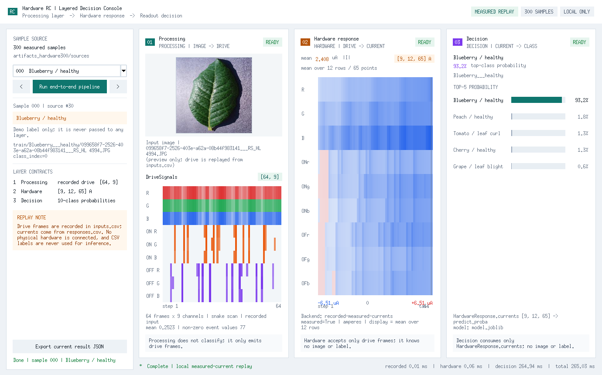
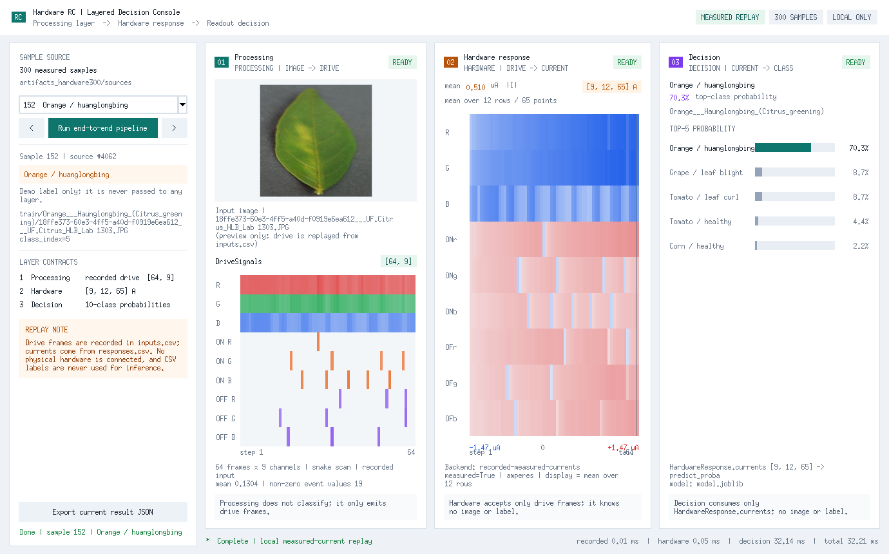

# 硬件 RC 分层链路交付说明

给吴睿学长：这次把「图像处理 → 硬件响应 → 决策读出」拆成了三个独立层，并补了一个**零额外 GUI 依赖**的 Tkinter 桌面演示程序。当前演示使用本地录制的 300 个实测样本回放，**没有连接物理硬件**。

## 截图

以下截图由程序内置的 `--capture-dir` 直接抓取真实 Tk 窗口，不是设计稿。



*样本 000 · 蓝莓健康 · 最高类概率 93.2% · 使用录制驱动与实测电流回放。*



*样本 152 · 橙黄龙病 · 最高类概率 70.3%，第二、第三名仍有可见概率，便于检查决策分布。*

## 分层边界

```text
图像 / 录制输入
      │
      ▼
┌─────────────────────────────────────────────┐
│ 处理层  processing.py                        │
│ 64×64 → 8×8 patch → 蛇形 64 帧 → [64, 9]    │
│ 只输出 DriveSignals，不导入分类器             │
└─────────────────────────────────────────────┘
      │  DriveSignals.frames: [64, 9]，归一化到 [0,1]
      ▼
┌─────────────────────────────────────────────┐
│ 硬件响应层  hardware.py                       │
│ 输入驱动帧，输出 9×12×65 安培电流             │
│ RecordedHardwareBackend / HttpHardwareBackend │
│ 不读图像、不做分类                            │
└─────────────────────────────────────────────┘
      │  HardwareResponse.currents: [9, 12, 65] A
      ▼
┌─────────────────────────────────────────────┐
│ 决策层  decision.py                          │
│ 只接收电流张量，调用冻结 readout 的 predict_proba │
│ 输出 10 类概率与 top-k                        │
└─────────────────────────────────────────────┘
      │
      ▼
Blueberry / healthy 93.2%（示例）
```

- `layers/contracts.py`：只定义三个数据契约和形状校验。
- `layers/orchestrator.py`：唯一同时持有三层的组合根 `HardwareRCPipeline`。
- 三层分别可单独导入、单独测试；处理层不分类，硬件层不解码图像，决策层不读文件路径或标签。
- 当前驱动器回放的是 `inputs.csv` 里已经导出的 64×9 处理层结果；截图中的原图仅作输入预览，不是重新跑图像预处理后的新数据。

## 桌面 Demo

入口：`rc/plantvillage_rc/desktop.py`，使用 **Python 标准库 Tkinter**，不新增第三方 GUI 依赖。

```bash
# 仓库根目录
PYTHONPATH=rc .venv/bin/python -m plantvillage_rc.desktop

# 打开指定样本（0–299）
PYTHONPATH=rc .venv/bin/python -m plantvillage_rc.desktop --sample-index 152

# 覆盖模型路径
PYTHONPATH=rc .venv/bin/python -m plantvillage_rc.desktop \
  --model artifacts_hardware300_v2/run/model.joblib
```

界面功能：

- 选择 300 个录制样本中的任意一个；
- 查看原图、`[64, 9]` 驱动矩阵和 `[9, 12, 65] A` 电流热图；
- 显示 10 类 top-5 概率和推理耗时；
- 将当前结果导出为 JSON（不包含 7020 个原始电流值）。

重新生成截图：

```bash
xvfb-run -a -s '-screen 0 1600x1000x24' \
  env PYTHONPATH=rc .venv/bin/python -m plantvillage_rc.desktop \
  --capture-dir docs/assets
```

## 数据与模型

| 内容 | 位置 | 是否进入 Git |
|---|---|---|
| 300 个实测电流 CSV | `artifacts_hardware300/sources/responses.csv` | 否 |
| 300 个录制驱动 CSV | `artifacts_hardware300/sources/inputs.csv` | 否 |
| 本地 readout 模型 | `artifacts_hardware300_v2/run/model.joblib` | 否（`*.joblib`） |
| 分层代码 | `rc/plantvillage_rc/layers/` | 是 |
| Tkinter 桌面端 | `rc/plantvillage_rc/desktop.py` | 是 |

模型加载时 sklearn 可能提示版本不一致（artifact 1.8.0，本地 1.9.1）；当前推理可正常运行，但正式部署应固定训练环境版本。

## 验证口径

- 300 个录制样本上的演示预测是**同批数据上的回放展示**，不能当作独立测试成绩。
- 第二轮硬件结果的三次五折平均准确率为 **90.67%**（宏 F1 90.67%，重复间标准差 1.53 个百分点），但仍属于同一批 300 张上的探索，不能视为独立泛化。
- 要确认真实泛化，需要固定此模型，再采集新的、带批次信息的硬件响应；当前没有独立测试集。
- 真实硬件未接入本次演示。`HttpHardwareBackend` 已定义：POST `frames: [64,9]`，返回 `{"currents_amperes": [9,12,65]}`；接真实器件时替换硬件后端即可，无需修改处理层或决策层。

## 复现检查

```bash
PYTHONPATH=rc .venv/bin/python -m pytest -q \
  rc/tests/test_pipeline.py rc/tests/test_hardware_v3.py
python tools/check_repository.py
```

桌面端预期：

- 样本 `000`：`Blueberry / healthy`，约 93.2%；
- 样本 `152`：`Orange / huanglongbing`，约 70.3%。

更多数据说明见 [九路真实硬件 300 样本说明](../rc/HARDWARE300.md) 与 [第二轮优化结果](../results/rc10_hardware300_v2/README.md)。
